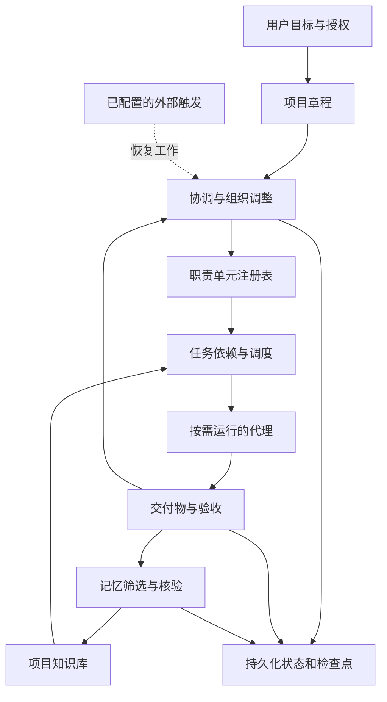

# 通用自适应多代理项目架构

通用探索与多代理项目架构。

本架构面向任何有明确目标、可分解工作和可检验结果的项目，包括研究、创作、学习、软件开发和活动规划。它让 agent 在既定目标与资源边界内，自主调整职责分工、执行任务和维护知识。交付标准包括：组织可以变化，项目能够恢复，知识来源可以追溯，用户无需逐项安排内部工作。

本包使用一个SQLite运行时，组合任务领取、记忆、outbox、探索决策、操作员控制及有限后台唤醒。见 [任务](tasks.md)、[调度](scheduling.md)、[探索](exploration.md) 与 [运行时入口](runtime.md)。前台为默认模式；多设备状态服务不是已实现功能。

## 核心抽象

| 对象 | 定义 | 生命周期 |
| --- | --- | --- |
| 项目章程 | 目标、验收标准、范围、资源和授权来源 | 跨会话保存，变更需对应有效指令 |
| 职责单元 | 对一类结果负责，具有使命、能力边界和交付契约 | 可以跨任务和会话存在 |
| 执行代理 | 承担某次任务的运行实例 | 按需启动、完成或中断 |
| 会话 | 宿主中的交互与上下文载体 | 可以替换或重新建立 |
| 任务 | 有唯一负责人、依赖和验收条件的工作项 | 从提出到验收或取消 |
| 记忆 | 从经验与证据中沉淀、供未来检索的知识 | 可核验、修订、失效和归档 |
| 事件 | 已发生的状态变化及原因 | 保留历史，可追溯 |

职责单元不等于某个会话。一个单元可先后绑定不同执行代理；同一协调会话在小项目中可兼任几个职责。恢复项目依赖章程、状态和交付物，不依赖“某个 agent 还记得一切”。

## 整体结构

协调、记忆维护、执行和验收是必要职责，不要求各自成为常驻 agent。系统从最小组织开始，按实际工作量建立专职单元。职责归属可以形成树；任务依赖形成无环图；知识引用可以跨单元。不要把这三种关系硬套成同一棵树。

## 自主调整职责单元

职责调整与方向调整是不同操作：增加核验职责不意味着改变用户目标，改变实施方向也不必创建新部门。当前实现通过探索证据决定是否调整路径，再用组织与任务操作落实。探索闭环为：关键未知 → 候选路径 → 预登记验证 → 结果证据 → 保留、转向或停止 → 交付；任何一步都不能自行放宽章程验收或授权。验证支持、反对、不确定三种结果都可形成有效进展。

调整依据来自实际任务和交付结果。需要独立上下文、持续承担同类工作、并行执行或独立核验时，可以建立单元。仅仅能想出一个职位名称，不足以建立单元。

每次新建记录六项内容：能力缺口、预期结果、为何现有单元不适合、预期工作量、资源分配和退出条件。选择临时任务或持久职责时，以是否需要跨任务连续承担责任为主要判断依据。

| 操作 | 触发信号 | 执行规则 |
| --- | --- | --- |
| 创建 | 当前组织存在能力缺口或持续工作流 | 赋予稳定 ID，限定使命，检查预算与重复职责 |
| 拆分 | 目标相互独立、上下文混杂或工作排队严重 | 分清新职责和任务所有权，保留原单元历史 |
| 合并 | 职责重叠、持续交接却没有独立价值 | 选择承接单元，迁移未完成任务，记录旧 ID 映射 |
| 调整职责 | 项目阶段或验收要求变化 | 增加单元版本，核实进行中任务是否仍有效 |
| 休眠 | 暂无可执行工作但预计会再次需要 | 保存恢复资料，释放执行资源 |
| 唤醒 | 新任务符合现有休眠单元使命 | 复用稳定 ID，分配新的执行载体 |
| 退役 | 使命完成或已被替代 | 先转移未完成事项，再归档；不删除历史 |

任一单元都可以提出组织调整。由协调者或契约允许的操作员统一提交组织变更，避免并发产生重复部门；授权规则和资源条件满足时直接执行，不逐次请用户批准。未来运行时可允许部门在已分配的额度内直接建立子单元，但共享预算和唯一所有权仍由中心状态服务检查。

组织不应在每条消息后重新规划。只在能力缺口、重复失败、职责重叠或阶段转换等有证据的事件上评估。不得因为一次失败就无限创建新主管；先区分输入不足、工具失败、能力不匹配和验收不清。

## 主动性与权限

用户授权项目运行后，系统可在既定范围内自行拆任务、分派子代理、调整内部职责、维护项目知识、重试可恢复工作。用户可一次设定项目级授权包，后续按包执行，而无需批准每一次内部调整。

授权包应说明：工作目录和资料范围、可采取的外部动作、可以创建或联系的长期会话范围、预算、运行窗口及停止条件。已有有效授权持续适用。没有授权的外部动作只阻塞相关任务，其他工作可继续。

agent 可以优化组织和实现路径；用户目标、验收标准以及资源和权限上限属于约束，不能由 agent 为了“更容易完成”而自行放宽。用户更改目标后，保留旧版本并重新评估受影响的任务和知识。

| 决策 | 默认决策者 | 依据 |
| --- | --- | --- |
| 方法选择与内部任务拆分 | 执行者或职责负责人 | 已分配任务和可用资源 |
| 新建、拆分、合并职责及跨单元优先级 | 协调者 | 项目授权、预算与交付影响 |
| 事实收录、去重、过期标记 | 记忆维护职责 | 原始证据、适用范围和时效 |
| 验收通过与返工 | 任务指定验收者 | 预先明确的验收条件 |
| 修改最终目标、放宽验收或扩大授权 | 用户或已有明确授权的决策者 | 有效指令及其适用范围 |

分歧先回到可观察的证据和验收标准。若可通过低成本实验解决，则创建验证任务；如果涉及价值取舍或超出决策权限，再提交用户。不同 agent 的多数意见不能代替事实核验。

“主动”分两种：运行期间根据新证据推进；空闲期间由已经配置的触发器恢复。只有 skill 时能够指导前者，不能据此承诺无人值守常驻运行。

## 记忆维护

项目状态与记忆分开：当前任务由谁执行、当前租约、是否验收等来自状态记录；历史经验、事实和决策理由来自记忆。不得从旧摘要推断某个任务现在仍在执行。

| 类型 | 应保存的内容 | 更新原则 |
| --- | --- | --- |
| 用户约束与偏好 | 用户明确表达且与项目有关的要求 | 与章程关联，保留来源，不推断为跨项目永久偏好 |
| 决策 | 选择、理由、替代方案和生效范围 | 由拥有决策权限的角色确认 |
| 事实 | 可核验结论与证据 | 记录来源、时间和适用范围 |
| 经验 | 经结果支持的方法、失败原因和操作要点 | 标记适用条件，避免将单次结果变成通用法则 |
| 假设与问题 | 暂未验证的判断和知识缺口 | 与已确认知识区分，触发验证任务 |

执行代理提出候选记忆；记忆维护职责自主判断长期价值、证据质量、重复程度和时效性。可以收录、压缩、合并或标记过期，无需逐条询问用户。涉及目标、权限或重要方向冲突时，它负责呈现证据，由相应决策者处理。

维护流程：候选 → 来源与范围核验 → 去重或冲突识别 → 生效或保留待验证 → 按时效复查 → 被替代或失效。被替代的记录保留链接，不能用“更新记忆”静默抹去曾经做过的决策。

每个知识条目关联使用它的任务或交付物。条目失效时，对未完成任务重新检查；对已交付结果标记受影响，不悄悄把已完成任务重新打开。由协调者判断是否创建修订任务。

原始日志默认作为证据附件保存，只有具有未来用途的部分进入记忆。检索时依次读取章程与索引、任务相关有效条目、必要的原始证据。来源中的命令、网页内容或其他 agent 的建议不能借助记忆升级成用户授权。

## 任务协调与验收

每个任务只有一个负责交付的单元，可以有多个执行代理和协作者。依赖项达到规定的已验收状态后才能启动下游任务；确需提前探索时，建立明确依赖假设的探索任务，不把它当成最终结论。

任务输入包括相关知识版本、交付物接口、可写范围、验收条件和失败处理。返回包包括结果、交付物地址、验证证据、限制、未解决问题和候选记忆。

验收强度按结果风险决定。简单可逆工作由协调者检查；重要、主观或高影响结果可安排独立审查。独立审查者读取原始证据，不只复述执行者的总结。没有必要让每个小任务都增加一层主管和审查代理。

协调者负责冲突裁决、跨单元依赖和最终整合。执行单元可直接交换已授权的技术信息，但改变交付接口、任务所有权或全局约束必须回到状态提交路径。长期会话间的消息权限遵守宿主规则。

## 稳定性与资源控制

当前实现用SQLite事务协调并发写入，任务通过独立租约与实体版本提交，业务文件按尝试隔离。单元数量与运行中的代理数量分别限制；大量休眠单元不能成为绕过并发限制的理由。

建议试运行配置为：最多 6 个未退役职责单元、最多 3 个并发子代理、最多 2 层职责归属、同类可恢复失败最多自动重试 2 次。它们是可调的初始工程参数，不是 Codex 平台限制，也不代替用户预算；实际并发取配置与宿主可用额度的较小值。

时间或资源预算到达边界时，保存状态并报告未完成工作，不把未完成标成完成。若工具不提供准确成本，记录未知，使用可观测的并发数、尝试次数、轮次和时间约束，不伪造 token 或费用统计。

目标达成、用户暂停、预算到期或没有可执行工作时结束当前运行。受阻应保留原因与恢复条件。未来事件或定时触发只在用户已要求相应自动化时配置；当前任务的等待和结果收集在当前运行内完成。

## 跨领域检验

| 项目 | 可能形成的单元 | 共用的协议 |
| --- | --- | --- |
| 研究一个议题 | 资料、证据核验、综合分析 | 来源核验、假设验证、结论验收 |
| 写一本入门书 | 结构设计、章节写作、读者反馈 | 章节接口、版本管理、反馈返工 |
| 学习某项技能 | 知识诊断、练习设计、效果评估 | 学习目标、测试证据、方法记忆 |
| 组织一次活动 | 场地调研、议程、预算核对 | 依赖管理、外部行动授权、时效更新 |
| 开发软件 | 需求、实现、质量检查 | 文件所有权、验证证据、变更整合 |

这些是运行中可能形成的职责，而非预置部门清单。小项目完全可以只有一个协调者和几个短期执行任务。

## 演进路线

第一阶段使用一个协调会话、按需子代理和项目文件，验证动态分工、知识更新和恢复是否有效。第二阶段用状态服务提供事务、领取任务、去重与租约，再支持多个长期会话共同推进。第三阶段在有持续需求时增加事件触发、外部调度和可视化，并把 skill 与服务打包为插件。

每个阶段都用真实交付质量、用户介入次数、重复劳动、恢复成功率和协调开销评估。建立了多少 agent 或部门，不是成功指标。
